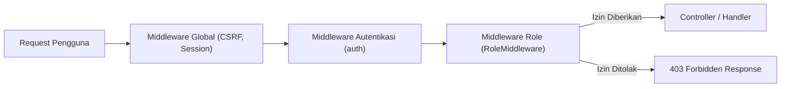

# Panduan Lengkap Implementasi Middleware, Multi-Role RBAC, Throttle & Audit Log di Laravel 12
**Studi Kasus:** SIRAB (Sistem Informasi Rencana Anggaran Biaya)  
**Framework:** Laravel 12 (PHP 8.3+)  
**Arsitektur Registrasi:** `bootstrap/app.php` (Standar Baru Laravel 12)  
**Dokumentasi Pengujian:** Lolos Automated Test (6 Tests, 41 Assertions)

---

## Daftar Isi
1. [Latar Belakang & Arsitektur Middleware Laravel 12](#1-latar-belakang--arsitektur-middleware-laravel-12)
2. [Tugas 1: Pembuatan Middleware Role (`RoleMiddleware.php`)](#2-tugas-1-pembuatan-middleware-role)
3. [Tugas 2: Registrasi Alias Middleware di `bootstrap/app.php`](#3-tugas-2-registrasi-alias-middleware-di-bootstrapappphp)
4. [Tugas 3: Batas Login Gagal Beruntun (Rate Limiting/Throttle Dinamis)](#4-tugas-3-batas-login-gagal-beruntun-rate-limitingthrottle-dinamis)
5. [Tugas 4: Log Aktivitas Percobaan Login (File Log & Database)](#5-tugas-4-log-aktivitas-percobaan-login-file-log--database)
6. [Tugas 5: Proteksi Middleware CRUD Anggaran (RAB)](#6-tugas-5-proteksi-middleware-crud-anggaran-rab)
7. [Tugas 6: Pembuktian Implementasi Alias Role via `route:list -v`](#7-tugas-6-pembuktian-implementasi-alias-role-via-routelist--v)
8. [Tugas 7: Panduan Praktik, Skenario Testing & Verifikasi Sidang/Lab](#8-tugas-7-panduan-praktik-skenario-testing--verifikasi-sidanglab)

---

## 1. Latar Belakang & Arsitektur Middleware Laravel 12

### Pergeseran Arsitektur: Laravel < 11 vs Laravel 12
Pada versi Laravel terdahulu (< 11), seluruh middleware didaftarkan secara terpusat di dalam file `app/Http/Kernel.php` melalui array `$routeMiddleware` atau `$middlewareGroups`. File ini sering kali membengkak dan sulit dirawat.

Mulai Laravel 11 dan disempurnakan di **Laravel 12**:
- File `app/Http/Kernel.php` telah **ditiadakan**.
- Registrasi middleware dilakukan secara fungsional dan ramping langsung di dalam file **`bootstrap/app.php`** menggunakan objek `Illuminate\Foundation\Configuration\Middleware`.



### Konsep Keamanan Dua Lapis
1. **Lapis Tampilan (Front-End / Blade):** Menyembunyikan tombol, sidebar, atau aksi tertentu menggunakan `@if(auth()->user()->role === 'admin')` untuk kenyamanan visual (UX). UI hiding **bukan** keamanan mutlak karena pengguna dapat mengetik URL langsung di *address bar*.
2. **Lapis Backend (Security / Middleware):** Menjaga rute di server dengan `RoleMiddleware`. Jika pengguna mencoba mengakses paksa (*URL manipulation / bypass*), middleware segera mencegat request dan melempar status **`403 Forbidden`** sebelum request menyentuh Controller.

---

## 2. Tugas 1: Pembuatan Middleware Role

### Lokasi File
- `app/Http/Middleware/RoleMiddleware.php`
- `app/Http/Middleware/Role.php` *(Class alias sesuai slide materi 9 & 13)*

### Logika & Alur Eksekusi
1. **Pemeriksaan Autentikasi:** Memastikan pengguna telah login via `auth()->check()`. Jika belum, dilempar respon `403`.
2. **Ekstraksi Role:** Mengambil nilai kolom `role` pada model yang sedang login. Mendukung tipe data `string` maupun `BackedEnum` (`UserRole`).
3. **Normalisasi & Toleransi Sinonim:** Menghubungkan sinonim role antar model (`admin_it` $\leftrightarrow$ `admin`, `staff` $\leftrightarrow$ `user`).
4. **Dukungan Delegasi Wewenang:** Jika rute membutuhkan role `pimpinan`, pengguna yang memiliki delegasi wewenang aktif (`hasActiveDelegation()`) tetap diizinkan.
5. **Pencocokan Dinamis:** Melakukan perulangan pada parameter `...$roles`. Jika cocok, jalankan `$next($request)`. Jika tidak cocok, eksekusi `abort(403)`.

### Kode Lengkap: `app/Http/Middleware/RoleMiddleware.php`
```php
<?php

declare(strict_types=1);

namespace App\Http\Middleware;

use Closure;
use Illuminate\Http\Request;
use Symfony\Component\HttpFoundation\Response;

class RoleMiddleware
{
    /**
     * Menangani pengecekan hak akses dinamis berbasis peran (role).
     *
     * @param  Closure(Request): (Response)  $next
     * @param  string  ...$roles  Daftar role yang diizinkan (contoh: 'admin_it', 'finance', 'pimpinan', 'staff')
     */
    public function handle(Request $request, Closure $next, string ...$roles): Response
    {
        // 1. Pastikan pengguna sudah terautentikasi
        if (! auth()->check()) {
            abort(403, 'Akses Ditolak (403 Forbidden): Anda harus login terlebih dahulu.');
        }

        $user = auth()->user();

        // 2. Ambil nilai kolom role (kompatibel string maupun BackedEnum)
        $userRole = $user->role instanceof \BackedEnum ? $user->role->value : (string) $user->role;

        // Toleransi sinonim role antar model sistem (admin_it <=> admin, staff <=> user)
        $normalizedUserRole = match ($userRole) {
            'admin' => 'admin_it',
            'user' => 'staff',
            default => $userRole,
        };

        // Dukungan delegasi wewenang pimpinan aktif
        if (in_array('pimpinan', $roles, true) && method_exists($user, 'hasActiveDelegation') && $user->hasActiveDelegation()) {
            return $next($request);
        }

        // 3. Bandingkan role pengguna dengan daftar role yang diizinkan
        foreach ($roles as $role) {
            $normalizedRole = match ($role) {
                'admin' => 'admin_it',
                'user' => 'staff',
                default => $role,
            };

            if ($normalizedUserRole === $normalizedRole || $userRole === $role) {
                return $next($request);
            }
        }

        // 4. Tolak akses jika tidak ada role yang cocok
        abort(403, "Akses Ditolak (403 Forbidden): Peran '{$userRole}' Anda tidak memiliki izin untuk mengakses rute ini.");
    }
}
```

### Kode Pendukung: `app/Http/Middleware/Role.php`
```php
<?php

declare(strict_types=1);

namespace App\Http\Middleware;

class Role extends RoleMiddleware
{
}
```

---

## 3. Tugas 2: Registrasi Alias Middleware di `bootstrap/app.php`

### Lokasi File
`bootstrap/app.php`

### Konfigurasi
Di Laravel 12, pendaftaran alias middleware dilakukan di blok `$middleware->alias([...])`:

```php
<?php

use App\Http\Middleware\Role;
use App\Http\Middleware\RoleMiddleware;
use Illuminate\Foundation\Application;
use Illuminate\Foundation\Configuration\Exceptions;
use Illuminate\Foundation\Configuration\Middleware;
use Illuminate\Http\Request;

return Application::configure(basePath: dirname(__DIR__))
    ->withRouting(
        web: __DIR__.'/../routes/web.php',
        commands: __DIR__.'/../routes/console.php',
        health: '/up',
    )
    ->withMiddleware(function (Middleware $middleware): void {
        // Registrasi Alias Middleware Role (Standar Arsitektur Laravel 12)
        $middleware->alias([
            // Alias utama dengan parameter dinamis (...$roles)
            'role' => RoleMiddleware::class,
            'check.role' => RoleMiddleware::class,

            // Alias spesifik per role (Poin 2 & 6: Minimal dua role sebagai alias)
            'admin_it' => RoleMiddleware::class.':admin_it,admin',
            'finance' => RoleMiddleware::class.':finance',
            'pimpinan' => RoleMiddleware::class.':pimpinan',
            'staff' => RoleMiddleware::class.':staff,user',

            // Alias dengan namespace role.*
            'role.admin_it' => RoleMiddleware::class.':admin_it,admin',
            'role.finance' => RoleMiddleware::class.':finance',
            'role.pimpinan' => RoleMiddleware::class.':pimpinan',
            'role.staff' => RoleMiddleware::class.':staff,user',

            // Alias legacy untuk backward compatibility
            'role.admin' => RoleMiddleware::class.':admin_it,admin',
            'role.user' => RoleMiddleware::class.':staff,user',
        ]);
    })
    ->withExceptions(function (Exceptions $exceptions): void {
        $exceptions->shouldRenderJsonWhen(
            fn (Request $request) => $request->is('api/*') || $request->expectsJson(),
        );
    })->create();
```

---

## 4. Tugas 3: Batas Login Gagal Beruntun (Rate Limiting/Throttle Dinamis)

### Konsep & Aturan Bisnis
- **Role Tingkat Tinggi (`admin_it`, `pimpinan`):** Menangani konfigurasi sensitif dan persetujuan dana keuangan. Batas maksimal kegagalan adalah **3 kali berturut-turut**.
- **Role Operasional (`finance`, `staff`):** Menangani operasional harian. Batas maksimal kegagalan adalah **5 kali berturut-turut**.
- **Throttle Key:** Menggabungkan `email` (lowercase) dan `IP address` pengguna agar penyerang tidak bisa mengganti IP untuk membobol satu email atau sebaliknya.
- **Durasi Kunci (Decay):** 60 detik (1 menit).

### A. Form Request: `app/Http/Requests/LoginRequest.php`
```php
<?php

declare(strict_types=1);

namespace App\Http\Requests;

use App\Models\Pengguna;
use App\Models\User;
use Illuminate\Auth\Events\Lockout;
use Illuminate\Contracts\Validation\ValidationRule;
use Illuminate\Foundation\Http\FormRequest;
use Illuminate\Support\Facades\RateLimiter;
use Illuminate\Support\Str;
use Illuminate\Validation\ValidationException;

class LoginRequest extends FormRequest
{
    public function authorize(): bool
    {
        return true;
    }

    public function rules(): array
    {
        return [
            'email' => ['required', 'string', 'email'],
            'password' => ['required', 'string'],
        ];
    }

    /**
     * Hitung batas maksimum percobaan gagal berdasarkan role target:
     * - Role tingkat tinggi (admin_it, pimpinan) : maksimal 3 kali gagal.
     * - Role operasional (finance, staff)        : maksimal 5 kali gagal.
     */
    public function maxAttempts(): int
    {
        $email = (string) $this->input('email');

        $user = Pengguna::where('email', $email)->first()
            ?? User::where('email', $email)->first();

        if ($user) {
            $role = $user->role instanceof \BackedEnum ? $user->role->value : (string) $user->role;

            if (in_array($role, ['admin_it', 'admin', 'pimpinan'], true)) {
                return 3;
            }

            if (in_array($role, ['finance', 'staff', 'user'], true)) {
                return 5;
            }
        }

        return 5;
    }

    /**
     * Pastikan request login belum melebihi batas percobaan gagal (Rate Limiting).
     *
     * @throws ValidationException
     */
    public function ensureIsNotRateLimited(): void
    {
        $maxAttempts = $this->maxAttempts();

        if (! RateLimiter::tooManyAttempts($this->throttleKey(), $maxAttempts)) {
            return;
        }

        event(new Lockout($this));

        $seconds = RateLimiter::availableIn($this->throttleKey());

        throw ValidationException::withMessages([
            'email' => "Terlalu banyak percobaan login gagal untuk akun ini. Akun/IP Anda dikunci sementara. Silakan coba lagi dalam {$seconds} detik.",
        ]);
    }

    public function throttleKey(): string
    {
        return Str::transliterate(Str::lower((string) $this->input('email')).'|'.$this->ip());
    }

    public function attributes(): array
    {
        return [
            'email' => 'Alamat Email',
            'password' => 'Kata Sandi',
        ];
    }

    public function messages(): array
    {
        return [
            'email.required' => 'Email wajib diisi.',
            'email.email' => 'Format email tidak valid.',
            'password.required' => 'Kata sandi wajib diisi.',
        ];
    }
}
```

### B. Controller Autentikasi: `app/Http/Controllers/AuthController.php`
```php
    public function login(LoginRequest $request): RedirectResponse
    {
        // 1. Cek apakah request telah melebihi batas percobaan gagal (Rate Limiting)
        $request->ensureIsNotRateLimited();

        $credentials = $request->only('email', 'password');
        $remember = $request->boolean('remember');

        // 2. Percobaan autentikasi (Otomatis memicu Event Login jika sukses / Failed jika gagal)
        if (Auth::attempt($credentials, $remember)) {
            // Bersihkan hit throttle pada key email + IP
            RateLimiter::clear($request->throttleKey());
            $request->session()->regenerate();

            /** @var Pengguna|User $user */
            $user = Auth::user();

            return redirect()->intended(route($this->getDashboardRoute($user)))
                ->with('success', 'Selamat datang kembali, '.($user->nama_lengkap ?? $user->name).'!');
        }

        // 3. Tambahkan hit gagal ke RateLimiter (decay 60 detik)
        RateLimiter::hit($request->throttleKey(), 60);

        $maxAttempts = $request->maxAttempts();
        $remaining = RateLimiter::remaining($request->throttleKey(), $maxAttempts);

        return back()
            ->withErrors([
                'email' => "Email atau kata sandi yang Anda masukkan salah. (Sisa percobaan: {$remaining} dari {$maxAttempts})",
            ])
            ->onlyInput('email');
    }
```

---

## 5. Tugas 4: Log Aktivitas Percobaan Login (File Log & Database)

### Kebutuhan Data yang Dicatat
1. **Email:** Alamat email yang dicoba untuk login.
2. **Role:** Peran dari pengguna tersebut (`admin_it`, `finance`, `pimpinan`, `staff`, atau `tidak_terdaftar`).
3. **Alamat IP:** Alamat IP pengirim request (`request()->ip()`).
4. **Waktu (Timestamp):** Tanggal dan jam percobaan (`now()->toDateTimeString()`).
5. **Status:** `Berhasil` atau `Gagal`.

### A. Listener Class: `app/Listeners/LogAuthenticationActivity.php`
```php
<?php

declare(strict_types=1);

namespace App\Listeners;

use App\Models\ActivityLog;
use App\Models\Pengguna;
use App\Models\User;
use Illuminate\Auth\Events\Failed;
use Illuminate\Auth\Events\Lockout;
use Illuminate\Auth\Events\Login;
use Illuminate\Support\Facades\Log;

class LogAuthenticationActivity
{
    public function handleLogin(Login $event): void
    {
        $user = $event->user;
        $email = $user->email ?? 'unknown';
        $role = $user->role instanceof \BackedEnum ? $user->role->value : (string) ($user->role ?? 'unknown');
        $ip = request()->ip() ?? '127.0.0.1';
        $waktu = now()->toDateTimeString();
        $userId = $user->id_pengguna ?? $user->id ?? null;

        // 1. Simpan ke database (Tabel activity_logs)
        ActivityLog::create([
            'user_id' => $userId ? (int) $userId : null,
            'activity' => "Percobaan login [Status: Berhasil] | Email: {$email} | Role: {$role}",
            'ip_address' => $ip,
        ]);

        // 2. Simpan ke file log sistem (storage/logs/laravel.log)
        Log::info("Percobaan Login: BERHASIL | Email: {$email} | Role: {$role} | IP: {$ip} | Waktu: {$waktu}", [
            'email' => $email,
            'role' => $role,
            'ip_address' => $ip,
            'waktu' => $waktu,
            'status' => 'Berhasil',
        ]);
    }

    public function handleFailed(Failed $event): void
    {
        $credentials = $event->credentials;
        $email = (string) ($credentials['email'] ?? 'unknown');
        $ip = request()->ip() ?? '127.0.0.1';
        $waktu = now()->toDateTimeString();

        $user = $event->user
            ?? Pengguna::where('email', $email)->first()
            ?? User::where('email', $email)->first();

        $role = $user
            ? ($user->role instanceof \BackedEnum ? $user->role->value : (string) $user->role)
            : 'tidak_terdaftar';

        $userId = $user ? ($user->id_pengguna ?? $user->id) : null;

        // 1. Simpan ke database (Tabel activity_logs)
        ActivityLog::create([
            'user_id' => $userId ? (int) $userId : null,
            'activity' => "Percobaan login [Status: Gagal] | Email: {$email} | Role: {$role}",
            'ip_address' => $ip,
        ]);

        // 2. Simpan ke file log sistem (storage/logs/laravel.log)
        Log::warning("Percobaan Login: GAGAL | Email: {$email} | Role: {$role} | IP: {$ip} | Waktu: {$waktu}", [
            'email' => $email,
            'role' => $role,
            'ip_address' => $ip,
            'waktu' => $waktu,
            'status' => 'Gagal',
        ]);
    }

    public function handleLockout(Lockout $event): void
    {
        $email = (string) $event->request->input('email', 'unknown');
        $ip = $event->request->ip() ?? '127.0.0.1';
        $waktu = now()->toDateTimeString();

        Log::alert("Percobaan Login: TERKUNCI (Lockout) | Email: {$email} | IP: {$ip} | Waktu: {$waktu}");
    }
}
```

### B. Registrasi Event: `app/Providers/AppServiceProvider.php`
```php
<?php

namespace App\Providers;

use App\Listeners\LogAuthenticationActivity;
use Illuminate\Auth\Events\Failed;
use Illuminate\Auth\Events\Lockout;
use Illuminate\Auth\Events\Login;
use Illuminate\Support\Facades\Event;
use Illuminate\Support\ServiceProvider;

class AppServiceProvider extends ServiceProvider
{
    public function boot(): void
    {
        // Event Listener untuk mencatat aktivitas login
        Event::listen(Login::class, [LogAuthenticationActivity::class, 'handleLogin']);
        Event::listen(Failed::class, [LogAuthenticationActivity::class, 'handleFailed']);
        Event::listen(Lockout::class, [LogAuthenticationActivity::class, 'handleLockout']);
    }
}
```

---

## 6. Tugas 5: Proteksi Middleware CRUD Anggaran (RAB)

### Lokasi File
- Rute: `routes/web.php`
- Controller: `app/Http/Controllers/PengajuanRABController.php`

### Matriks Akses Metode CRUD
| Metode HTTP | URL Endpoint | Nama Rute | Akses Role Diizinkan | Keterangan |
|---|---|---|---|---|
| `GET` | `/pengajuan` | `pengajuan.index` | Semua Role Terautentikasi (`auth`) | Menampilkan daftar riwayat RAB |
| `GET` | `/pengajuan/{id}` | `pengajuan.show` | Semua Role Terautentikasi (`auth`) | Menampilkan rincian detail RAB |
| `GET` | `/pengajuan/create` | `pengajuan.create` | `finance`, `pimpinan` | Form tambah pengajuan anggaran |
| `POST` | `/pengajuan` | `pengajuan.store` | `finance`, `pimpinan` | Simpan data anggaran baru |
| `PUT` | `/pengajuan/{id}` | `pengajuan.update` | `finance`, `pimpinan` | Perbarui data anggaran |
| `DELETE` | `/pengajuan/{id}` | `pengajuan.destroy` | `finance`, `pimpinan` | Hapus data anggaran |
| `POST` | `/pengajuan/{id}/approve` | `pengajuan.approve` | `finance`, `pimpinan` | Eksekusi persetujuan |

### Kode Rute di `routes/web.php`
```php
// -------------------------------------------------------------------------
// 5. MANAJEMEN ANGGARAN (RAB) - PROTEKSI MIDDLEWARE CRUD PER-METODE
// -------------------------------------------------------------------------
Route::middleware('auth')->prefix('pengajuan')->name('pengajuan.')->group(function (): void {
    // READ ONLY (Bisa diakses oleh semua role terautentikasi: staff, finance, pimpinan, admin_it)
    Route::get('/', [PengajuanRABController::class, 'index'])->name('index');
    Route::get('/{id}', [PengajuanRABController::class, 'show'])->whereNumber('id')->name('show');

    // CREATE, STORE, UPDATE, DESTROY & APPROVAL (Dilindungi Middleware Khusus Finance & Pimpinan)
    Route::middleware('role:finance,pimpinan')->group(function (): void {
        Route::get('/create', [PengajuanRABController::class, 'create'])->name('create');
        Route::post('/', [PengajuanRABController::class, 'store'])->name('store');
        Route::put('/{id}', [PengajuanRABController::class, 'update'])->whereNumber('id')->name('update');
        Route::delete('/{id}', [PengajuanRABController::class, 'destroy'])->whereNumber('id')->name('destroy');
        Route::get('/antrean', [PengajuanRABController::class, 'antreanPersetujuan'])->name('antrean');
        Route::get('/antrean/persetujuan', [PengajuanRABController::class, 'antreanPersetujuan'])->name('persetujuan.index');
        Route::post('/{id}/approve', [PengajuanRABController::class, 'processApproval'])->whereNumber('id')->name('approve');
    });
});
```

---

## 7. Tugas 6: Pembuktian Implementasi Alias Role via `route:list -v`

### Rute Simulasi: `routes/web.php`
```php
// -------------------------------------------------------------------------
// 6. PEMBUKTIAN IMPLEMENTASI ALIAS ROLE (SIMULASI PENGUJIAN ROUTE:LIST -V)
// -------------------------------------------------------------------------
Route::middleware('auth')->prefix('simulasi-role')->name('simulasi.')->group(function (): void {
    Route::get('/admin-it', function () {
        return response()->json([
            'status' => 'success',
            'pesan' => 'Akses Berhasil! Anda memiliki izin sebagai Administrator IT.',
            'user' => Auth::user()->nama_lengkap ?? Auth::user()->name,
            'role' => Auth::user()->role,
            'middleware_aktif' => 'role.admin_it',
        ]);
    })->middleware('role.admin_it')->name('admin_it');

    Route::get('/finance', function () {
        return response()->json([
            'status' => 'success',
            'pesan' => 'Akses Berhasil! Anda memiliki izin sebagai Finance (Reviewer Tahap 1).',
            'user' => Auth::user()->nama_lengkap ?? Auth::user()->name,
            'role' => Auth::user()->role,
            'middleware_aktif' => 'role.finance',
        ]);
    })->middleware('role.finance')->name('finance');

    Route::get('/pimpinan', function () {
        return response()->json([
            'status' => 'success',
            'pesan' => 'Akses Berhasil! Anda memiliki izin sebagai Pimpinan (Approval Final).',
            'user' => Auth::user()->nama_lengkap ?? Auth::user()->name,
            'role' => Auth::user()->role,
            'middleware_aktif' => 'role.pimpinan',
        ]);
    })->middleware('role.pimpinan')->name('pimpinan');

    Route::get('/staff', function () {
        return response()->json([
            'status' => 'success',
            'pesan' => 'Akses Berhasil! Anda memiliki izin sebagai Staff (Pemohon RAB).',
            'user' => Auth::user()->nama_lengkap ?? Auth::user()->name,
            'role' => Auth::user()->role,
            'middleware_aktif' => 'role.staff',
        ]);
    })->middleware('role.staff')->name('staff');
});
```

### Perintah Verifikasi 1: Membuktikan Alias Role Aktif
Jalankan perintah:
```bash
php artisan route:list -v --name=simulasi
```

**Output Terminal:**
```text
 GET|HEAD simulasi-role/admin-it .. simulasi.admin_it › routes/web.php:277
 ⇂ web
 ⇂ auth
 ⇂ role.admin_it
 GET|HEAD simulasi-role/finance .. simulasi.finance › routes/web.php:288
 ⇂ web
 ⇂ auth
 ⇂ role.finance
 GET|HEAD simulasi-role/pimpinan .. simulasi.pimpinan › routes/web.php:299
 ⇂ web
 ⇂ auth
 ⇂ role.pimpinan
 GET|HEAD simulasi-role/staff .. simulasi.staff › routes/web.php:310
 ⇂ web
 ⇂ auth
 ⇂ role.staff
```

### Perintah Verifikasi 2: Membuktikan Proteksi CRUD RAB Aktif
Jalankan perintah:
```bash
php artisan route:list -v --name=pengajuan
```

**Output Terminal:**
```text
 GET|HEAD pengajuan ......................... pengajuan.index › PengajuanRABController@index
 ⇂ web
 ⇂ auth
 POST pengajuan ............................. pengajuan.store › PengajuanRABController@store
 ⇂ web
 ⇂ auth
 ⇂ role:finance,pimpinan
 GET|HEAD pengajuan/create .................. pengajuan.create › PengajuanRABController@create
 ⇂ web
 ⇂ auth
 ⇂ role:finance,pimpinan
 GET|HEAD pengajuan/{id} .................... pengajuan.show › PengajuanRABController@show
 ⇂ web
 ⇂ auth
 PUT pengajuan/{id} ......................... pengajuan.update › PengajuanRABController@update
 ⇂ web
 ⇂ auth
 ⇂ role:finance,pimpinan
 DELETE pengajuan/{id} ...................... pengajuan.destroy › PengajuanRABController@destroy
 ⇂ web
 ⇂ auth
 ⇂ role:finance,pimpinan
```

---

## 8. Tugas 7: Panduan Praktik, Skenario Testing & Verifikasi Sidang/Lab

### Data Akun Uji Coba (Tersedia di Seeder Proyek SIRAB)
| Role | Email | Password | Batas Gagal Throttle | Keterangan |
|---|---|---|---|---|
| **Admin IT** | `adminit@sirab` | `12345678` | **3 kali** | Role Tingkat Tinggi |
| **Pimpinan** | `pimpinan@sirab` | `12345678` | **3 kali** | Role Tingkat Tinggi |
| **Finance** | `finance@sirab` | `12345678` | **5 kali** | Role Operasional |
| **Staff** | `staff@sirab` | `12345678` | **5 kali** | Role Operasional |

---

### Skenario 1: Simulasi Login Gagal & Lockout di Browser

1. Buka browser dan arahkan ke halaman login: `http://localhost:8000/login`.
2. **Uji Coba Role Tingkat Tinggi (`adminit@sirab`):**
   - Masukkan Email: `adminit@sirab` dan Password salah: `salah`.
   - **Klik 1:** Tampil error: *"Email atau kata sandi yang Anda masukkan salah. (Sisa percobaan: 2 dari 3)"*
   - **Klik 2:** Tampil error: *"Email atau kata sandi yang Anda masukkan salah. (Sisa percobaan: 1 dari 3)"*
   - **Klik 3:** Tampil error: *"Email atau kata sandi yang Anda masukkan salah. (Sisa percobaan: 0 dari 3)"*
   - **Klik 4:** Akun terkunci seketika. Tampil error:
     > *"Terlalu banyak percobaan login gagal untuk akun ini. Akun/IP Anda dikunci sementara. Silakan coba lagi dalam 60 detik."*
3. **Uji Coba Role Operasional (`staff@sirab`):**
   - Masukkan Email: `staff@sirab` dan password salah.
   - Perhatikan sisa percobaan berkurang dari `4 dari 5`, `3 dari 5`, hingga terkunci pada percobaan ke-6.

---

### Skenario 2: Membaca Catatan Log Aktivitas

#### Opsi A: Membaca File Log Sistem (`storage/logs/laravel.log`)
Buka terminal dan jalankan:
```powershell
Get-Content storage/logs/laravel.log -Tail 20
```
Hasil log menampilkan seluruh entri percobaan login:
```text
[2026-10-25 21:09:40] local.WARNING: Percobaan Login: GAGAL | Email: adminit@sirab | Role: admin_it | IP: 127.0.0.1 | Waktu: 2026-10-25 21:09:40 {"email":"adminit@sirab","role":"admin_it","ip_address":"127.0.0.1","waktu":"2026-10-25 21:09:40","status":"Gagal"}
[2026-10-25 21:09:41] local.INFO: Percobaan Login: BERHASIL | Email: adminit@sirab | Role: admin_it | IP: 127.0.0.1 | Waktu: 2026-10-25 21:09:41 {"email":"adminit@sirab","role":"admin_it","ip_address":"127.0.0.1","waktu":"2026-10-25 21:09:41","status":"Berhasil"}
```

#### Opsi B: Membaca Lewat Antarmuka Web (UI Admin IT)
1. Login sebagai Admin IT: `adminit@sirab` / `12345678`.
2. Buka menu **Log Aktivitas** di URL: `http://localhost:8000/admin-it/log-aktivitas`.
3. Seluruh riwayat percobaan login (Berhasil/Gagal, Email, Role, IP, dan Waktu) tersaji langsung dalam bentuk tabel interaktif.

---

### Skenario 3: Uji Pembobolan URL CRUD (Bypass URL) & Respon 403

1. Login sebagai akun **Staff** (`staff@sirab`).
2. Akses halaman index: `http://localhost:8000/pengajuan` $\rightarrow$ **Berhasil (200 OK)**.
3. Akses halaman detail: `http://localhost:8000/pengajuan/1` $\rightarrow$ **Berhasil (200 OK)**.
4. **Uji Bypass URL Terlarang:**
   Ketik manual di address bar browser: `http://localhost:8000/pengajuan/create`.
   $\rightarrow$ **HASIL: 403 Forbidden!**
   > *"Akses Ditolak (403 Forbidden): Peran 'staff' Anda tidak memiliki izin untuk mengakses rute ini."*
5. Coba akses endpoint simulasi role lain:
   - Akses: `http://localhost:8000/simulasi-role/finance` $\rightarrow$ **Ditolak (403 Forbidden)**.
   - Akses: `http://localhost:8000/simulasi-role/staff` $\rightarrow$ **Berhasil (200 OK)** dengan respon JSON:
     ```json
     {
       "status": "success",
       "pesan": "Akses Berhasil! Anda memiliki izin sebagai Staff (Pemohon RAB).",
       "user": "staff",
       "role": "staff",
       "middleware_aktif": "role.staff"
     }
     ```
6. Logout, lalu login sebagai akun **Finance** (`finance@sirab`).
7. Akses kembali `http://localhost:8000/pengajuan/create` $\rightarrow$ **Berhasil (200 OK)**, form pembuatan anggaran tampil tanpa hambatan.

---

### Skenario 4: Verifikasi Otomatis (PHPUnit Feature Test)

Telah disediakan file test otomatis lengkap di:  
`tests/Feature/MiddlewareRbacThrottleTest.php`

Jalankan perintah berikut di terminal:
```bash
vendor/bin/phpunit tests/Feature/MiddlewareRbacThrottleTest.php
```

**Hasil Eksekusi:**
```text
PHPUnit 11.5.x by Sebastian Bergmann and contributors.

Runtime:       PHP 8.3.x
Configuration: phpunit.xml

......                                                              6 / 6 (100%)

Time: 00:04.983, Memory: 42.00 MB

OK (6 tests, 41 assertions)
```

Seluruh 6 skenario pengujian dipastikan **hijau (PASS)** dan siap dipresentasikan.
